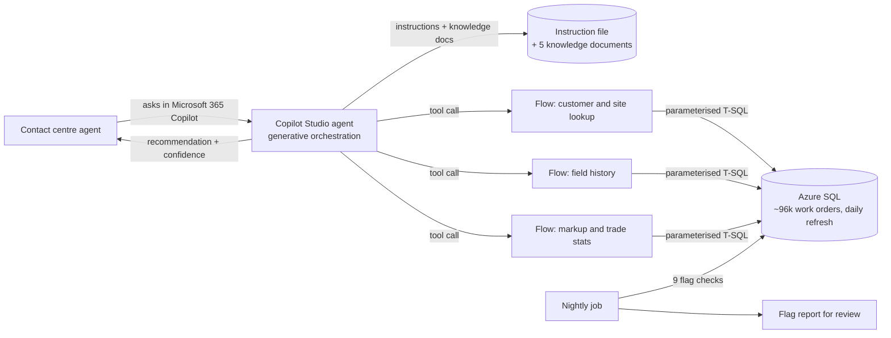

# Work Order Copilot Agent

**A Microsoft Copilot Studio agent that recommends the fields needed to open a service work order, grounded in five years of company work-order history, plus a nightly data-quality check that flags new work orders that look wrong.**


> **Case study.** I built this during my 2026 co-op term at Black & McDonald. The agent, flows, queries and data belong to the company and are not published here.
> This repository documents the problem, architecture and decisions, and includes a small **independent demo** (`demo/`) that recreates the data-quality idea on **synthetic data** so the approach can be run and reviewed.

## At a glance

| | |
|---|---|
| **Users** | Customer Contact Centre agents who open corrective service work orders |
| **What it does** | Recommends the 8 ERP (JD Edwards) fields an agent needs to open a work order; recommends only, with no write access to the ERP |
| **Grounding data** | Azure SQL table of ~96,000 historical work orders covering ~5 years, refreshed daily |
| **Integration** | 3 Power Automate flows that run parameterised T-SQL on behalf of the agent |
| **Second capability** | A nightly verification query with 9 flag types that scores new work orders against history |
| **Status at end of term** | Demoed and validated live against the ERP by a subject-matter expert; handed over with a 19-document handover pack |

## The problem

Opening a corrective work order means choosing the right customer, site, trade, markup and several other ERP codes. Agents relied on memory and on asking colleagues, and mistakes flowed downstream into billing, where they are expensive to find and fix. The history needed to make a good choice already existed in five years of past work orders, but nobody could query it while on a call.

## Architecture



Details: [docs/architecture.md](docs/architecture.md).

## Engineering decisions

| Decision | Why |
|---|---|
| **Recommend, never write** | The ERP stays the system of record and the agent cannot create bad data. Every recommendation is confirmed by a person. |
| **Tools run parameterised SQL through flows** | Keeps the model away from free-form query generation, makes every lookup auditable, and stops injection through user input. |
| **Confidence in two dimensions** | Markup depends on customer **and** trade: at the same customer the markup table differed about 3 times in 4. One customer with 485 work orders had a top markup share of only 1.6%, which made a single "most common value" misleading. |
| **Never hide ambiguous flags** | The data cannot tell an entry error from a legitimate variation. Ambiguous markup flags were therefore split into `MARKUP` and `MARKUP SPLIT` instead of being suppressed. The same principle turned 16 equipment flags into 1 serious and 15 minor. See [docs/verification-flags.md](docs/verification-flags.md). |
| **Model chosen by test, not by default** | In a three-model comparison one candidate fabricated a markup rate under test and was rejected. See [docs/model-evaluation.md](docs/model-evaluation.md). |

## Results

- Cut consumption from **22 to 17 credits per setup (about 23%)** by removing a redundant tool call.
- Investigated a **341% capacity overage** (3,414 consumed against 999 allocated) and traced it to an unrelated flow in the same environment, not the agent.
- Nightly verification produced **43 flags on a 7-day run and 62 on a 10-day run** for review.
- Validated live against the ERP by the business, with a pilot group planned after handover.

## Try the demo

The demo builds a synthetic work-order table in SQLite and runs flag checks of the same style (window functions and common table expressions). No company data or code is used.

```bash
cd demo
python3 run_demo.py          # generates synthetic data, runs the checks, prints a flag report
```

## Tech

Microsoft Copilot Studio (generative orchestration, tools, knowledge sources), Microsoft 365 Copilot, Power Automate, Azure SQL, T-SQL (CTEs, window functions), prompt and instruction design, model evaluation. Demo: Python, SQLite.
